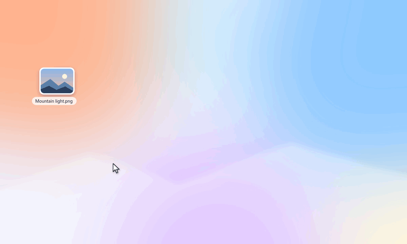

<p align="center">
  <picture>
    <source media="(prefers-color-scheme: dark)" srcset="docs/media/banner-dark.svg">
    
  </picture>
</p>

<p align="center">
  <a href="https://github.com/Chaos-Tic/Lorenz/actions/workflows/ci.yml"></a>
</p>

# Lorenz

**Drag a file. Tap a key. Drop onto a choice.**

> *Why Lorenz?* The project is named after **Edward Lorenz** (1917–2008), the
> meteorologist whose work founded chaos theory and gave us the **butterfly
> effect**. Fitting for a tool by [Chaos-Tic](https://github.com/Chaos-Tic): a
> small gesture, a whole file transformed.

<p align="center">
  
</p>

Lorenz puts three wheels under your cursor while you drag a file: **Shift** converts
it, **Ctrl** edits it (compress, resize, rotate, split, merge…) and **Alt** acts on it
(copy, move, share, terminal…). Everything runs locally with the engines installed
on your computer. Originals are never modified: `photo.png` becomes `photo.webp`,
and a tool produces `photo-compressed.png`. A number is added only when a name is
already taken. No account, server, or cloud service is involved; the only network
use is a once-a-day check for a newer release on GitHub, which you can turn off
in Settings.

The global drag gesture works on **Windows 10 and 11** and on **KDE Plasma 6.8
(Wayland)**. Every other Linux desktop gets the same wheels from the file manager's
context menu. The interface speaks English and French, following the system or the
language picked at setup. Lorenz is an independent project inspired by Tangerine
for Mac (see [Acknowledgements](#acknowledgements)). **Status: under development**:
what is verified and what is not yet done are listed in
[Roadmap and known gaps](#roadmap-and-known-gaps).

[Install](#install-on-linux) · [The three wheels](#three-wheels) · [Formats and tools](#what-lorenz-can-do) · [Desktop guide](docs/USER_GUIDE.md) · [Troubleshooting](docs/TROUBLESHOOTING.md)

<p align="center">
  <picture>
    <source media="(prefers-color-scheme: dark)" srcset="docs/media/three-wheels-dark.png">
    
  </picture>
</p>

*Real wheels captured during a Wayland file drag in an isolated KWin session.*

## Three wheels

| Key (default) | Wheel | What it offers |
| --- | --- | --- |
| **Shift** | Convert | Every format the selection can become, grouped by family |
| **Ctrl** | Tools | Compress, resize, rotate, mirror, black & white, remove metadata, normalize audio, split or merge PDFs, extract or create archives… |
| **Alt** | Actions | Share, Float, Copy, Copy to…, Move to…, Copy path, Terminal, Show in folder |

1. Start dragging one or more files (or folders) from your file manager.
2. **Tap** Shift, Ctrl or Alt while holding the mouse button. The wheel opens at the cursor and stays open.
3. Tap another of these keys to switch wheels in place.
4. Move onto a sector, or use the arrow keys, then release the mouse button (or press Enter).

Escape, the center, or the outside of the wheel cancels. A key already held *before*
the drag starts keeps its usual meaning, so Ctrl-drag still copies and Shift-drag still
moves in your file manager. The keys can be changed in **Settings** (tray icon).

<details>
<summary>Watch the wheels switch</summary>


</details>

## Install on Linux

### Arch Linux (AUR)

Lorenz is available on the [AUR](https://aur.archlinux.org/packages/lorenz) for Arch
and its derivatives (EndeavourOS, Manjaro, CachyOS):

```sh
yay -S lorenz
```

Any AUR helper works the same way (`paru -S lorenz`). Pick the conversion engines you
want from the optional dependencies.

### Fedora (COPR)

Fedora 43 and later, built from source by [Fedora COPR](https://copr.fedorainfracloud.org/coprs/chaostic/lorenz/);
`dnf upgrade` keeps it up to date:

```sh
sudo dnf copr enable chaostic/lorenz
sudo dnf install lorenz
```

### Debian and Ubuntu (apt)

Debian 12+, Ubuntu 24.04+ and their derivatives, from the
[Chaos-Tic apt repository](https://chaos-tic.github.io/apt); `apt upgrade`
keeps it up to date:

```sh
sudo curl -fsSLo /usr/share/keyrings/chaos-tic.gpg https://chaos-tic.github.io/apt/chaos-tic-apt.gpg
echo "deb [signed-by=/usr/share/keyrings/chaos-tic.gpg] https://chaos-tic.github.io/apt stable main" |
  sudo tee /etc/apt/sources.list.d/chaos-tic.list
sudo apt update && sudo apt install lorenz
```

### Ready-made packages

Download the file for your distribution from the **Releases** page, and check it
against the release's `SHA256SUMS` ([how](docs/VERIFYING.md)):

| Distribution | File | Install |
| --- | --- | --- |
| Debian 12+, Ubuntu 24.04+, Mint 22+ | `lorenz_VERSION_amd64.deb` | `sudo apt install ./lorenz_*.deb` |
| Fedora (current release) | `lorenz-VERSION-1.fcNN.x86_64.rpm` | `sudo dnf install ./lorenz-*.rpm` |
| Arch, EndeavourOS, CachyOS | `lorenz-VERSION-1-x86_64.pkg.tar.zst` | `sudo pacman -U lorenz-*.pkg.tar.zst` |
| Any other (glibc 2.35+) | `Lorenz-x86_64.AppImage` | `chmod +x Lorenz-*.AppImage`, then run it |

Packages install Lorenz for every user, with its application-menu entry and the
Dolphin and Nemo context menus, and recommend the conversion engines (apt and dnf
install recommended packages by default; on Arch, pick them from the optional
dependencies). Nautilus users run `lorenz integrate` once for the GNOME Files
scripts; `lorenz autostart enable` starts the tray companion at login. The
AppImage bundles Qt but no engines and adds no file-manager menus. The KDE drag
gesture is not packaged: it must be built against your exact KWin version
(`./scripts/install-kwin.sh`).

### From source

```sh
git clone https://github.com/Chaos-Tic/Lorenz.git
cd Lorenz
./install.sh
```

The installer detects your distribution, builds Lorenz from source, and installs it
**for your user only** in `~/.local`. It asks before each optional step:

| Question | Default | What happens |
| --- | --- | --- |
| Install build tools? | Yes | Rust, a C++ compiler, CMake and Qt 6 through your package manager (asks for your password). If your Rust is older than 1.85, it offers the official `rustup` installer. |
| Install conversion engines? | Yes | FFmpeg, ImageMagick, Pandoc, Poppler, qpdf, Ghostscript, libarchive, clipboard tools. Unavailable packages are skipped, not fatal. |
| Install LibreOffice? | No | Adds Word/ODT → PDF, PowerPoint and spreadsheet routes (large download). |
| Install the KWin extension? | Yes, on KDE Plasma 6.8 | Builds the drag gesture against your KWin version and loads it without restarting the session (asks for your password). |
| **Start Lorenz when you log in?** | Yes | Adds the tray companion to your session's autostart. Answer *No* to start it only from the application menu. |

You can change the startup choice and the keys later from the tray icon → **Settings…**,
or with `lorenz autostart enable` / `lorenz autostart disable`.

### Supported distributions

| Family | Examples | Package manager | Installer validated in a clean container |
| --- | --- | --- | --- |
| Arch | Arch, EndeavourOS, Manjaro, CachyOS | pacman | ✅ `archlinux:latest`; also used on the developer's KDE desktop |
| Debian | Debian, Ubuntu, Linux Mint, Pop!_OS | apt | ✅ `debian:stable`, `ubuntu:24.04` (Rust installed through rustup) |
| Fedora | Fedora, Nobara, RHEL-like with EPEL | dnf | ✅ `fedora:latest` |
| openSUSE | Tumbleweed, Leap | zypper | Package list provided, not yet validated |
| Void, Alpine | | xbps, apk | Package list provided, not yet validated |
| Others | | — | Install the [requirements](#manual-installation) yourself, then run `./install.sh --no-deps` |

### Unattended installation

```sh
./install.sh --yes                       # recommended answers, including start at login
./install.sh --yes --no-autostart        # same, without starting at login
./install.sh --no-deps --kwin --office   # use installed packages; force the optional parts
./install.sh --help                      # every option
```

### Manual installation

Requirements: Rust ≥ 1.85, a C++17 compiler, CMake ≥ 3.21 and Qt 6 Widgets ≥ 6.4.
Optional engines: `ffmpeg`, ImageMagick (`magick`, or `convert` from version 6),
`pandoc`, Poppler (`pdftotext`, `pdftoppm`), `qpdf`, `gs`, `bsdtar`, `soffice`,
and `wl-copy` or `xclip` for clipboard actions.

<details>
<summary>Package commands per distribution</summary>

```sh
# Arch and derivatives
sudo pacman -S --needed base-devel cmake rust qt6-base libnotify \
  ffmpeg imagemagick pandoc-cli poppler qpdf ghostscript libarchive wl-clipboard xclip
# Debian, Ubuntu and derivatives (Ubuntu 24.04: install Rust with rustup)
sudo apt install build-essential cmake cargo rustc qt6-base-dev pkg-config libnotify-bin \
  ffmpeg imagemagick pandoc poppler-utils qpdf ghostscript libarchive-tools wl-clipboard xclip
# Fedora (enable RPM Fusion for full FFmpeg codecs)
sudo dnf install gcc-c++ cmake cargo rust qt6-qtbase-devel libnotify \
  ffmpeg-free ImageMagick pandoc poppler-utils qpdf ghostscript bsdtar wl-clipboard xclip
# openSUSE
sudo zypper install gcc-c++ cmake cargo rust qt6-widgets-devel libnotify-tools \
  ffmpeg-7 ImageMagick pandoc poppler-tools qpdf ghostscript bsdtar wl-clipboard xclip
```

LibreOffice: `libreoffice-fresh` (Arch), `libreoffice-writer-nogui libreoffice-calc-nogui
libreoffice-impress-nogui` (Debian/Ubuntu), `libreoffice-writer libreoffice-calc
libreoffice-impress` (Fedora, openSUSE).

KWin extension build files: `kwin extra-cmake-modules vulkan-headers` (Arch),
`kwin-dev extra-cmake-modules libvulkan-dev` (Debian/Ubuntu), `kwin-devel
extra-cmake-modules vulkan-headers` (Fedora), `kwin6-devel extra-cmake-modules
vulkan-devel` (openSUSE).

</details>

To install just the core app and desktop integration from a source checkout,
without the interactive helper:

```sh
cargo build --release --locked
cmake -S . -B build -DCMAKE_BUILD_TYPE=Release -DBUILD_TESTING=OFF
cmake --build build
cmake --install build --prefix "$HOME/.local"
```

Cargo builds the Rust command; CMake builds the Qt interface and installs both,
with the launcher, menus, icon and license, through one standard install rule.
Distribution packages run `DESTDIR="$pkgdir" cmake --install build --prefix /usr`
to stage those files without changing the live system. `install.sh` uses the
same rule and additionally offers conversion engines, the KWin gesture and
autostart.

### Update and uninstall

```sh
git pull && ./install.sh     # rebuilds and replaces the installed version
./uninstall.sh               # removes Lorenz, its menus, autostart and the KWin extension
```

Rebuild after every KWin update: the extension is tied to the compositor version.
Uninstalling never touches your files.

### Where it works

| Desktop | How to open the wheels |
| --- | --- |
| KDE Plasma 6.8, Wayland | Drag a file and tap Shift / Ctrl / Alt anywhere |
| KDE (other versions), GNOME, Cinnamon | Right-click → **Lorenz** (Dolphin, Nautilus scripts, Nemo) |
| XFCE (Thunar) | Add a custom action: `lorenz-desktop --wheel convert %F` |
| Hyprland, Sway, niri | Bind a key to `lorenz pick FILE --menu fuzzel` (or `wofi`, `rofi`) |
| Any | `lorenz` command line, or the batch manager from the tray icon |

## Install on Windows

Windows 10 (1809 or later) or Windows 11, no build tools needed:

1. Download **Lorenz-Setup-x64.exe** from the repository's **Releases** page (or
   the *package-windows* artifact of the latest successful **Build and test** run).
2. Double-click it. The installer is not signed yet: if Windows SmartScreen warns,
   choose *More info → Run anyway*.
3. Tick what you want, then *Install*:
   - a desktop shortcut;
   - the conversion engines through winget (ImageMagick, FFmpeg, Pandoc, Poppler,
     qpdf), recommended;
   - LibreOffice for Word, PowerPoint and spreadsheet files (large, optional);
   - start Lorenz when you sign in.

Lorenz is installed for your account only, in `%LOCALAPPDATA%\Programs\Lorenz`,
without administrator rights, and added to **Start** and **Send to**.

**Drag gesture:** while the Lorenz companion runs (tray icon), drag files from
Explorer or any app, tap **Shift** (convert), **Ctrl** (tools) or **Alt**
(actions), and release over a sector of the wheel that opens under the pointer.
Tap another key, or point at a tab, to switch wheels; release elsewhere or press
Esc to drop normally. The wheel always takes a *copy*, so a drag that would move
files never removes the originals. Right-click files → **Send to → Lorenz**
opens the same wheels without dragging. Archives use the
`tar` included with Windows; *Compress PDF* needs Ghostscript, which is not on
winget (install it from ghostscript.com if needed). Engine installers may ask for
administrator rights; Lorenz itself does not.

To update, run a newer installer over the old one. To uninstall: **Settings → Apps
→ Lorenz → Uninstall**; engines stay installed (`winget uninstall` removes them).
Unattended install, choosing the tasks:

```powershell
Lorenz-Setup-x64.exe /VERYSILENT /TASKS="desktopicon,engines,autostart"
```

**From source** (developers): with Rust, MSVC C++ build tools, CMake and Qt 6
(`CMAKE_PREFIX_PATH` set, `windeployqt` on `PATH`), run
`./scripts/install-windows.ps1` from the checkout; it asks the same questions.

CI builds the installer, installs and uninstalls it silently on Windows, tests the
wheel's copy-only drops and runs real conversions there; interactive validation of
the drag gesture on Windows 10/11 is in progress.

## What Lorenz can do

### Convert (Shift)

| Family | Engine | Formats |
| --- | --- | --- |
| Images | ImageMagick | PNG, JPG, WebP, TIFF, BMP, AVIF, PDF (several images make one PDF); HEIC and GIF input |
| Video | FFmpeg | MP4, MOV, MKV, WebM, AVI, WMV, GIF |
| Audio | FFmpeg | MP3, M4A, WAV, FLAC, OGG, Opus, AIFF, WMA; audio from any video |
| Documents | Pandoc · LibreOffice | MD, DOCX, EPUB, HTML, ODT, TXT; RTF input; DOCX/DOC/ODT/RTF → PDF |
| Slides | LibreOffice | PPT/PPTX/ODP → PDF, PPTX, ODP; first slide → PNG, JPG |
| Spreadsheets | LibreOffice | XLSX, XLS, ODS, CSV → XLSX, ODS, CSV, PDF |
| PDF | Poppler | Text; every page → PNG or JPG at 300 dpi (a folder when there are several) |
| Subtitles | FFmpeg | SRT ↔ VTT |
| Archives | libarchive | ZIP, TAR, TGZ (GZ, BZ2, XZ, 7Z and RAR input) |

### Tools (Ctrl)

| Family | Tools |
| --- | --- |
| Images | Compress, Resize 50%, Rotate right/left, Mirror, Black & white, Remove metadata |
| Video | Compress (H.264), Remove audio, Half size, Rotate right, Speed ×2, First frame |
| Audio | Normalize volume, Mono, Compress |
| PDF | Compress, Merge (2+ files), Split pages, Pages to PNG (300 dpi), Rotate right |
| Archives | Extract into a new folder |
| Anything | Compress to ZIP (files and folders) |

### Actions (Alt)

| Action | Requires |
| --- | --- |
| Share | KDE Connect (`kdeconnect-handler`) |
| Float | A drag-and-drop helper: `dragon-drop`, `dragon` or `ripdrag` |
| Copy · Copy path | `wl-copy` (Wayland) or `xclip` (X11); PowerShell on Windows |
| Copy to… · Move to… | Nothing: a folder picker opens; existing names are never replaced |
| Terminal | Your desktop's terminal (Konsole, GNOME Terminal, Ptyxis, kitty, foot, …) |
| Show in folder | Your file manager |

Only items that work on your computer appear: a missing engine hides its routes.
Selections show what all selected items have in common. These routes are declared in
[`registry/conversions.toml`](registry/conversions.toml) and
[`registry/tools.toml`](registry/tools.toml); a declared route is not a certification
of every codec. HEIC, AVIF and H.264 support depends on how your engines were built.

Engines are hardened but not isolated by an operating-system sandbox; keep them
updated and be careful with files from untrusted sources:

- ImageMagick decodes each file with the coder named by its extension and runs under
  a private policy that refuses script, text, URL and `@file` coders and delegates.
  SVG input is not offered, because SVG renderers can embed other local files.
- LibreOffice runs with a private temporary profile that never updates links and
  blocks macros and active content; it never touches your open documents.
- Pandoc reads documents with `--sandbox`. The output is then written outside the
  sandbox (distribution builds cannot write DOCX or EPUB inside it), through a
  filter that keeps only the document's own images, a few plain metadata fields,
  and no raw HTML in EPUB, so nothing else on disk can be embedded.
  FFmpeg reads local files only.
- Archives are extracted by bsdtar, which refuses absolute paths and `..` entries.

## Command line

```sh
lorenz doctor                                   # installed engines and session
lorenz menu convert photo.png                   # what each wheel offers
lorenz menu tools photo.png --json
lorenz convert photo.png --to webp
lorenz convert movie.mov --to mp4 --output-dir ./exports
lorenz tool compress photo.jpg holiday.png      # photo-compressed.jpg, holiday-compressed.png
lorenz tool merge part1.pdf part2.pdf           # Merged.pdf
lorenz action copy-to --dest ~/Backup report.pdf
lorenz autostart enable                         # start the tray companion at login
lorenz pick photo.png --menu fuzzel             # dmenu-style picker for tiling desktops
lorenz-desktop --wheel tools photo.png          # open a wheel without dragging
```

`--json` prints one JSON line per result with `ok`, `input`, and `output` or `error`;
the exit status is 1 if anything fails. `--timeout` limits an engine run (3600 s by
default) and `--cancel-file` stops it as soon as that file appears. `serve` is a
sequential JSON Lines worker on stdin/stdout with no network socket.

Outputs are written to a hidden `.lorenz-*` folder beside the destination, then
published atomically with a hard link, which FAT/exFAT do not support. After a power
failure, such folders can be deleted once no conversion is running.

## Development and verification

```sh
cargo fmt --check
cargo clippy --locked --all-targets -- -D warnings
cargo test --locked                              # real engines; missing ones are skipped
cmake -S . -B build -DCMAKE_BUILD_TYPE=Release && cmake --build build
ctest --test-dir build                           # wheel geometry, modes and keyboard
./scripts/test-kwin-isolated.sh                  # real drag in a private KWin session
./scripts/test-install-container.sh debian:stable  # the installer in a clean container
```

CI builds and tests the core on Linux and Windows, the Qt desktop on both, the core
on Debian stable/testing, Arch and Fedora stable/rawhide, the KWin extension on Arch,
and runs the installer in clean Debian, Ubuntu, Fedora and Arch containers.

## Documentation

| Guide | What it covers |
| --- | --- |
| [Interaction guide](docs/USER_GUIDE.md) | The three wheels, keys, cancellation, settings, batch manager |
| [KWin integration](integrations/kwin/README.md) | Drag gesture scope, installation, isolated tests, removal |
| [Troubleshooting](docs/TROUBLESHOOTING.md) | Missing engines, Pandoc, filesystems, startup, desktop integration |
| [Architecture](docs/ARCHITECTURE.md) | Data flow, source map, registries, process interfaces |
| [Validation](docs/TESTING.md) | Automated coverage and a manual platform checklist |
| [Distribution](packaging/README.md) | Package repositories and how each release reaches them |
| [Compatibility](docs/COMPATIBILITY.md) | What was verified, where and when |
| [Verifying downloads](docs/VERIFYING.md) | SHA-256 checksums and repository keys |
| [Security](SECURITY.md) | Reporting a vulnerability, threat model, known limits |
| [Changelog](CHANGELOG.md) | What changed in each release |
| [Visual assets](docs/media/README.md) | Screenshot provenance and refresh instructions |

## Roadmap and known gaps

Not done yet, in rough order of priority:

- **Engine isolation.** Engines run as your user with Lorenz's restrictions
  (ImageMagick policy, Pandoc sandbox, FFmpeg limited to local files, private
  LibreOffice profile) and a timeout; they are not confined further
  (no bubblewrap or AppContainer) and have no memory or CPU limit. See
  [SECURITY.md](SECURITY.md).
- **File type detection** relies on extensions; content (MIME) detection is
  planned. Each engine still parses the content itself.
- **Real-machine testing.** CI and containers cover building, installing and
  headless runs; real sessions are verified only where
  [docs/COMPATIBILITY.md](docs/COMPATIBILITY.md) says so (GNOME, Windows 10/11
  and other desktops wait for a dated check).
- **Windows signing.** Installers are unsigned (see
  [Code signing](#code-signing)); a winget package is not published yet.
- **Official distribution archives.** Lorenz is in the AUR, a Fedora COPR, an
  Ubuntu PPA and its own apt repository, not in the official Debian, Ubuntu or
  Fedora archives (they require a sponsor and every Rust crate packaged
  separately).
- **Features:** drag gesture for GNOME Shell and wlroots compositors; SVG input
  through a sandboxed renderer; tools with parameters (crop, trim, quality);
  PDF to DOCX/EPUB; Apple Pages input; codec probing and progress reporting;
  Flatpak.
- **macOS:** not started.

## Acknowledgements

Lorenz is an independent project inspired by
[Tangerine for macOS](https://www.tangerineformac.com/). Full credit to the
creators of Tangerine for the original interaction concept that inspired this
project. Lorenz is developed independently, contains no Tangerine source code,
and is not affiliated with or endorsed by Tangerine, nor with any namesake
franchise.

## License

Lorenz is free software under the [GNU General Public License v3.0 or later](LICENSE).

## Code signing

Windows installers are **not code-signed** yet: Windows SmartScreen may warn
before running them. Do not disable SmartScreen or your antivirus; instead,
download only from the [official channels](#official-download-channels) and
compare the file with the release's `SHA256SUMS` as described in
[docs/VERIFYING.md](docs/VERIFYING.md). A checksum proves the file is the one
published here; it does not replace a publisher signature. On Linux, COPR,
Launchpad and the Chaos-Tic apt repository sign their package indexes, which
your package manager checks; the AUR package builds from this repository's
source tarball, pinned by its SHA-256 in the PKGBUILD.

## Official download channels

Lorenz is published only by [Chaos-Tic](https://github.com/Chaos-Tic) through:

- this repository's [Releases](https://github.com/Chaos-Tic/Lorenz/releases);
- the AUR package [`lorenz`](https://aur.archlinux.org/packages/lorenz);
- the Fedora COPR [`chaostic/lorenz`](https://copr.fedorainfracloud.org/coprs/chaostic/lorenz/);
- the Ubuntu PPA [`ppa:chaos-tic/lorenz`](https://launchpad.net/~chaos-tic/+archive/ubuntu/lorenz);
- the apt repository [chaos-tic.github.io/apt](https://chaos-tic.github.io/apt);
- the [KDE Store](https://store.kde.org/p/2379605).

Copies elsewhere are not maintained here. Releases up to now are GPL-3.0-or-later,
so redistributing them under that license is allowed; if you find a copy that
breaks the license or impersonates the project, please
[open an issue](https://github.com/Chaos-Tic/Lorenz/issues).

### Privacy

Lorenz converts files on your computer. It does not transfer any information to
other networked systems unless specifically requested by the user or the person
installing or operating it: the Windows installer downloads conversion engines
through winget only when you tick that option.
