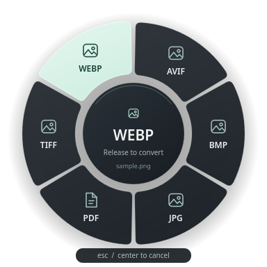

<p align="center">
  
</p>

<p align="center">
  <a href="https://github.com/Chaos-Tic/Metroid/actions/workflows/ci.yml"></a>
</p>

# Metroid

**Drag a file. Tap Shift. Drop onto a format.**

Metroid brings a conversion wheel to your cursor without opening a batch window.
The global gesture is implemented for **KDE Plasma / KWin 6.8 on Wayland**. The
Rust conversion core and secondary Qt batch manager also build on Linux and Windows.
The filename stays the same: `photo.png` becomes `photo.webp`. A number is added
only when the destination already exists (`photo-2.webp`). Originals are preserved. No account, application server, or cloud service is required.

**Status: under development. The Shift-drag integration is KWin-specific.** This is an independent implementation;
it contains no Tangerine source code and is not affiliated with any namesake franchise.
All repository documentation, commit messages, comments, and application text are in English.

[Get started](#linux-installation) · [Desktop guide](docs/USER_GUIDE.md) · [Formats](#implemented-conversions) · [Troubleshooting](docs/TROUBLESHOOTING.md) · [Architecture](docs/ARCHITECTURE.md)

## At a glance

| Shift-drag workflow | Local processing | Original files preserved |
| --- | --- | --- |
| Tap Shift while dragging a local file | Installed engines and a Rust core | New output names; no silent replacement |
| Release the key; the wheel stays open | No account or application server | Center / Escape to cancel |



*Actual wheel captured during a Wayland file drag in an isolated KWin session.*

<details>
<summary>View the animated workflow</summary>


Native widget frames show the opening and hover transitions. The still image above
shows the highlighted sector without motion.

</details>

## Designed around the gesture

A graphite palette, rounded format petals, and a pale mint selection keep the wheel
readable without a large window. The center shows the source filename and the selected
format. Image, audio, video, and document glyphs distinguish the available choices.

Opening takes 220 ms; hover transitions follow the pointer, and dismissal takes 110 ms.
Selection targets stay fixed during animation. A reading indicator covers discovery,
and an explicit unavailable state handles files without a common conversion route.
The context wheel, tray icon, and secondary batch manager share the same visual identity.

## Convert without opening a window

1. Start dragging a local file from Dolphin or another Wayland application.
2. **Tap Shift** while holding the mouse button. The wheel opens at the cursor.
3. Release Shift and move onto the desired format.
4. Release the mouse button to convert. A notification reports the result.

Drop in the center or outside the wheel, or press **Escape**, to cancel. Shift
without a file drag does nothing. A drag without Shift keeps its normal behavior.
Metroid cancels the source's move operation before converting, so Shift does not
move or delete the original. Mixed selections show only common formats.

Launching Metroid from the application menu opens a small tray companion.
**Open batch manager** is available from its menu when you need queue management;
it is no longer the primary workflow. File-manager context actions open the small
format wheel directly. See the [interaction guide](docs/USER_GUIDE.md).

## Linux installation

Requirements: stable Rust (2024 edition), a C++ compiler, CMake ≥ 3.21, Qt6 Widgets ≥ 6.4.

```sh
./scripts/install-linux.sh
```

The user installation adds the desktop, core, icon, and Nautilus, Dolphin, and Nemo
integrations. It starts no background service. Optional engines: ImageMagick 7
(`magick`), FFmpeg, Pandoc, Poppler, and qpdf. Install them through your distribution's
package manager. Engine detection does not guarantee every codec: HEIC, AVIF, and
H.264 support depends on the installed builds.

For Thunar, create a custom action using `metroid gui %F`. On other desktops,
pass a file to `metroid pick` or use a file-manager context action. These are
fallbacks, not global Shift-drag support.

### Enable Shift-drag on KDE Wayland

Install KWin 6.8 development headers, Extra CMake Modules, Vulkan headers, and the
Qt/KDE build dependencies, then run:

```sh
./scripts/install-kwin.sh
```

This builds an extension against the installed KWin version, installs its production
module into Qt's plugin directory (administrator access), loads it without restarting
KWin, and enables it for future logins. No input-device permissions or raw keyboard
access are granted. **Rebuild after a KWin update**; incompatible versions are rejected.
See the [KWin integration guide](integrations/kwin/README.md) for scope, validation,
and removal.

## Windows installation

Install Rust, MSVC C++ build tools, CMake, and Qt6 for MSVC. Set `CMAKE_PREFIX_PATH`
to Qt and put its tools on `PATH`, then run:

```powershell
./scripts/install-windows.ps1
```

The user installation adds Metroid to Start and Send to. Install conversion engines
separately and put them on `PATH`. Windows compilation is configured in CI;
interactive Windows 10/11 validation remains pending. The Windows global Shift-drag
gesture is not implemented yet; use the file-context wheel or batch manager there.

## Implemented conversions

| Family | Engine | Scope |
| --- | --- | --- |
| Images | ImageMagick 7 | PNG, JPG, WebP, TIFF, BMP, AVIF, PDF; HEIC input |
| Audio | FFmpeg | MP3, M4A, WAV, FLAC, OGG, Opus, AIFF; audio extraction from video |
| Video | FFmpeg | MP4, MOV, MKV, WebM, AVI, GIF |
| Documents | Pandoc | MD, DOCX, EPUB, HTML, ODT, TXT; RTF input |
| PDF | Poppler | Text and first-page PNG at 150 dpi |
| Subtitles | FFmpeg | SRT ↔ VTT |
| PDF merging | qpdf | `merge-pdf` CLI command |

The registry lives in `registry/conversions.toml` and is embedded at build time.
These are declared routes, not certification of every combination or codec. Input
detection currently uses extensions; engines validate content. Multipage images
may produce extra files that are not published: this version targets single-page images.

Pandoc runs with `--sandbox`. Some Pandoc distributions cannot export DOCX/ODT in
this mode unless their data files are embedded. Metroid keeps this protection and
reports the failure; use a Pandoc build with `embed_data_files` for those formats.
See the [Pandoc manual](https://pandoc.org/MANUAL.html#general-options). External
resources are not automatically fetched. External engines are not isolated by an
OS sandbox: local processing is not a network guarantee for every delegate or
protection against vulnerabilities in those engines.

## Command line

```sh
metroid doctor
metroid formats photo.png --json
metroid convert photo.png --to webp
metroid convert movie.mov --to mp4 --output-dir ./exports
metroid merge-pdf chapter1.pdf chapter2.pdf --output-dir ./exports
metroid pick photo.png --menu fuzzel
metroid gui photo.png
```

`convert --json` emits one JSON line per file, containing `ok`, `input`, and `output`
or `error`. Exit status is 1 if any conversion fails. `--timeout` sets the time
limit in seconds (3600 by default). `--cancel-file` names a signal file: its appearance
stops the engine and cleans up temporary output. `serve` is a sequential JSON Lines
worker on stdin/stdout with no network socket:

```json
{"input":"/path/photo.png","to":"webp","output_dir":"/path/exports"}
```

Normal shutdown cleans temporary files. A power failure can leave `.metroid-*`
directories beside outputs; remove them only after checking that no conversion is
running. Atomic publication uses hard links: filesystems without hard-link support,
such as FAT/exFAT, return an error. Desktop queues do not persist across launches.

## Development and verification

```sh
cargo fmt --check
cargo clippy --locked --all-targets -- -D warnings
cargo test --locked
cargo build --release --locked
cmake -S . -B build -DCMAKE_BUILD_TYPE=Release
cmake --build build --parallel 2
QT_QPA_PLATFORM=offscreen build/metroid-desktop --smoke-test
```

Tests use installed engines and explicitly skip missing optional engines. CI covers
Rust and Qt on Linux/Windows, plus Debian stable/testing, Arch, and Fedora stable/rawhide
for the core. Desktop-specific behavior also needs manual validation, described in
`docs/TESTING.md`.

## Documentation

| Guide | What it covers |
| --- | --- |
| [Interaction guide](docs/USER_GUIDE.md) | Shift-drag, cancellation, context wheel, secondary batch manager |
| [KWin integration](integrations/kwin/README.md) | Installation, supported versions, isolated gesture tests, removal |
| [Troubleshooting](docs/TROUBLESHOOTING.md) | Missing engines, Pandoc, filesystems, desktop integration |
| [Architecture](docs/ARCHITECTURE.md) | Data flow, source map, subprocess interfaces, extension points |
| [Validation](docs/TESTING.md) | Automated coverage and a manual platform checklist |
| [Distribution](packaging/README.md) | Installation boundaries and packaging plans |
| [Visual assets](docs/media/README.md) | Screenshot provenance and refresh instructions |

## Roadmap

- Content/MIME detection, detailed engine/codec capabilities, per-engine progress.
- Process-tree cancellation and operating-system resource limits.
- Persistent worker queues, notifications, configurable local history.
- Safe archive extraction, Office/LibreOffice, spreadsheets, multipage PDF output.
- Compression, resizing, cropping, and trimming with desktop controls.
- Additional compositor integrations and a native Windows Shift-drag implementation.
- Tools/actions wheels and configurable trigger keys.
- Context-menu validation across desktops and Windows 11 integration.
- Native packages, Flatpak/AppImage, signed Windows installer, publication license.

See `packaging/README.md` for distribution plans. No redistribution license has
been granted yet; a license must be chosen before public distribution.
