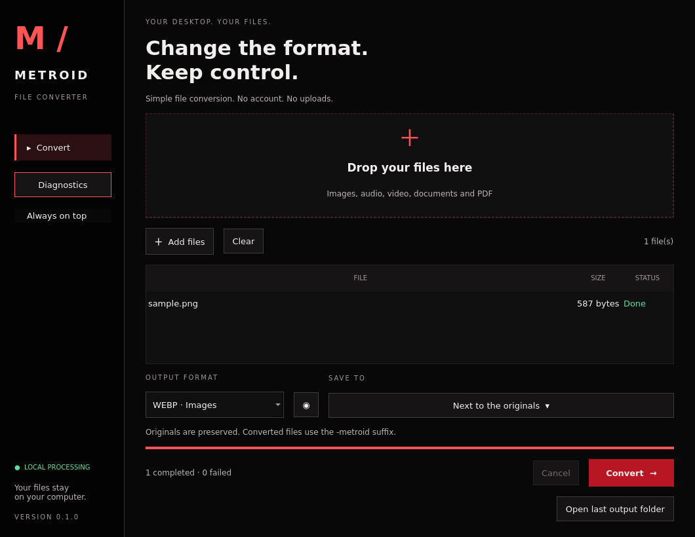
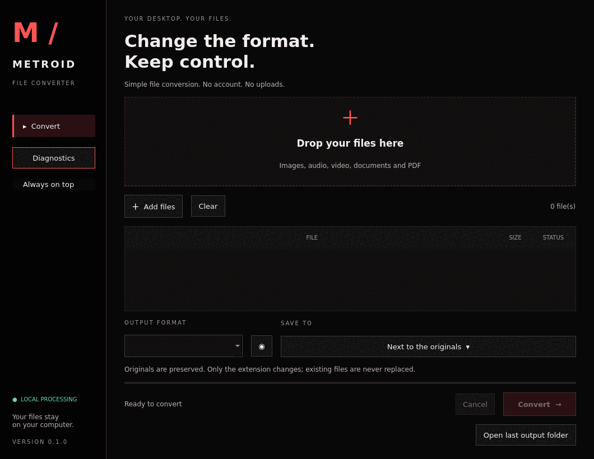

<p align="center">
  
</p>

<p align="center">
  <a href="https://github.com/Chaos-Tic/Metroid/actions/workflows/ci.yml"></a>
</p>

# Metroid

A native file converter for Linux and Windows, with a Rust core and a Qt6 desktop.
Original files are preserved and conversions run on your computer. No account,
application server, or cloud service is required.

**Status: version 0.1, under development.** This is an independent implementation;
it contains no Tangerine source code and is not affiliated with any namesake franchise.
All repository documentation, commit messages, comments, and application text are in English.

[Get started](#linux-installation) · [Desktop guide](docs/USER_GUIDE.md) · [Formats](#implemented-conversions) · [Troubleshooting](docs/TROUBLESHOOTING.md) · [Architecture](docs/ARCHITECTURE.md)

## At a glance

| Local workflow | Native desktop | Original files preserved |
| --- | --- | --- |
| Run installed engines on your computer | Qt6 interface with a Rust core | New output names; no silent replacement |
| No account or application server | Drop area, format wheel, batch queue | Cancellation and temporary-output cleanup |



*Actual application screenshot using a generated sample image.*

<details>
<summary>View the animated workflow</summary>



A short slideshow of actual app captures, not a real-time recording. The still
image above shows the final state without motion.

</details>

## Using the desktop

Open **Metroid** from your application menu, drop files, choose an output format,
and click **Convert**. The list shows formats shared by all selected files whose
engine is installed. The round button opens the format wheel. `Ctrl+O` adds files;
`Escape` requests cancellation. Diagnostics lists local engines. Hover over a file's
status to see detailed errors.

Output names use `name-metroid.ext`, then `name-metroid-2.ext`, and so on. Files are
processed sequentially. An error does not stop the remaining queue; cancellation
does. File paths are passed directly to processes, never through a shell.

## Linux installation

Requirements: stable Rust (2024 edition), a C++ compiler, CMake ≥ 3.21, Qt6 Widgets ≥ 6.4.

```sh
./scripts/install-linux.sh
```

The user installation adds the desktop, core, icon, and Nautilus, Dolphin, and Nemo
integrations. It starts no background service. Optional engines: ImageMagick 7
(`magick`), FFmpeg, Pandoc, Poppler, and qpdf. Install them through your distribution's
package manager. Engine detection does not guarantee every codec: HEIC, AVIF, and
H.264 support depends on the installed builds.

On Wayland, the desktop uses a regular window; always-on-top behavior depends on
the compositor. No global drag operations or keystrokes are intercepted. For Thunar,
create a custom action using `metroid gui %F`. On a tiling desktop, bind a shortcut
to `metroid gui`, or pass a file to `metroid pick`.

## Windows installation

Install Rust, MSVC C++ build tools, CMake, and Qt6 for MSVC. Set `CMAKE_PREFIX_PATH`
to Qt and put its tools on `PATH`, then run:

```powershell
./scripts/install-windows.ps1
```

The user installation adds Metroid to Start and Send to. Install conversion engines
separately and put them on `PATH`. Windows compilation is configured in CI;
interactive Windows 10/11 validation remains pending.

## Implemented conversions

| Family | Engine | Scope |
| --- | --- | --- |
| Images | ImageMagick 7 | PNG, JPG, WebP, TIFF, BMP, AVIF, PDF; HEIC input |
| Audio | FFmpeg | MP3, M4A, WAV, FLAC, OGG, Opus, AIFF; audio extraction from video |
| Video | FFmpeg | MP4, MOV, MKV, WebM, AVI, GIF |
| Documents | Pandoc | MD, DOCX, EPUB, HTML, ODT, TXT; RTF input |
| PDF | Poppler | Text and first-page PNG at 150 dpi |
| Subtitles | FFmpeg | SRT ↔ VTT |
| PDF merging | qpdf | `merge-pdf` CLI command |

The registry lives in `registry/conversions.toml` and is embedded at build time.
These are declared routes, not certification of every combination or codec. Input
detection currently uses extensions; engines validate content. Multipage images
may produce extra files that are not published: this version targets single-page images.

Pandoc runs with `--sandbox`. Some Pandoc distributions cannot export DOCX/ODT in
this mode unless their data files are embedded. Metroid keeps this protection and
reports the failure; use a Pandoc build with `embed_data_files` for those formats.
See the [Pandoc manual](https://pandoc.org/MANUAL.html#general-options). External
resources are not automatically fetched. External engines are not isolated by an
OS sandbox: local processing is not a network guarantee for every delegate or
protection against vulnerabilities in those engines.

## Command line

```sh
metroid doctor
metroid formats photo.png --json
metroid convert photo.png --to webp
metroid convert movie.mov --to mp4 --output-dir ./exports
metroid merge-pdf chapter1.pdf chapter2.pdf --output-dir ./exports
metroid pick photo.png --menu fuzzel
metroid gui photo.png
```

`convert --json` emits one JSON line per file, containing `ok`, `input`, and `output`
or `error`. Exit status is 1 if any conversion fails. `--timeout` sets the time
limit in seconds (3600 by default). `--cancel-file` names a signal file: its appearance
stops the engine and cleans up temporary output. `serve` is a sequential JSON Lines
worker on stdin/stdout with no network socket:

```json
{"input":"/path/photo.png","to":"webp","output_dir":"/path/exports"}
```

Normal shutdown cleans temporary files. A power failure can leave `.metroid-*`
directories beside outputs; remove them only after checking that no conversion is
running. Atomic publication uses hard links: filesystems without hard-link support,
such as FAT/exFAT, return an error. Desktop queues do not persist across launches.

## Development and verification

```sh
cargo fmt --check
cargo clippy --locked --all-targets -- -D warnings
cargo test --locked
cargo build --release --locked
cmake -S . -B build -DCMAKE_BUILD_TYPE=Release
cmake --build build --parallel 2
QT_QPA_PLATFORM=offscreen build/metroid-desktop --smoke-test
```

Tests use installed engines and explicitly skip missing optional engines. CI covers
Rust and Qt on Linux/Windows, plus Debian stable/testing, Arch, and Fedora stable/rawhide
for the core. Desktop-specific behavior also needs manual validation, described in
`docs/TESTING.md`.

## Documentation

| Guide | What it covers |
| --- | --- |
| [Desktop guide](docs/USER_GUIDE.md) | First conversion, batches, status messages, cancellation |
| [Troubleshooting](docs/TROUBLESHOOTING.md) | Missing engines, Pandoc, filesystems, desktop integration |
| [Architecture](docs/ARCHITECTURE.md) | Data flow, source map, subprocess interfaces, extension points |
| [Validation](docs/TESTING.md) | Automated coverage and a manual platform checklist |
| [Distribution](packaging/README.md) | Installation boundaries and packaging plans |
| [Visual assets](docs/media/README.md) | Screenshot provenance and refresh instructions |

## Roadmap

- Content/MIME detection, detailed engine/codec capabilities, per-engine progress.
- Process-tree cancellation and operating-system resource limits.
- Persistent worker queues, notifications, configurable local history.
- Safe archive extraction, Office/LibreOffice, spreadsheets, multipage PDF output.
- Compression, resizing, cropping, and trimming with desktop controls.
- XDG portals, optional layer-shell support, desktop-specific global shortcuts.
- Context-menu validation across desktops and Windows 11 integration.
- Native packages, Flatpak/AppImage, signed Windows installer, publication license.

See `packaging/README.md` for distribution plans. No redistribution license has
been granted yet; a license must be chosen before public distribution.
