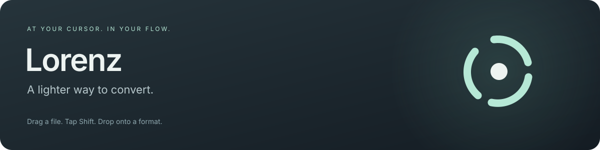
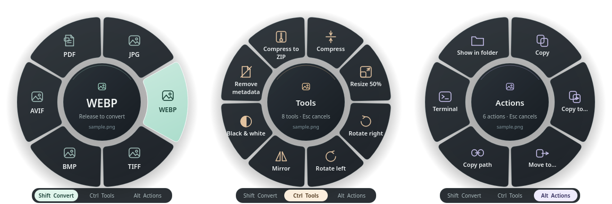

<p align="center">
  
</p>

<p align="center">
  <a href="https://github.com/Chaos-Tic/Metroid/actions/workflows/ci.yml"></a>
</p>

# Metroid

**Drag a file. Tap a key. Drop onto a choice.**

Metroid puts three wheels under your cursor while you drag a file: **Shift** converts
it, **Ctrl** edits it (compress, resize, rotate, split, merge…) and **Alt** acts on it
(copy, move, share, terminal…). Everything runs locally with the engines installed
on your computer. Originals are never modified: `photo.png` becomes `photo.webp`,
and a tool produces `photo-compressed.png`. A number is added only when a name is
already taken. No account, server, or cloud service is involved.

The global drag gesture is implemented for **KDE Plasma 6.8 on Wayland**. Every
other Linux desktop gets the same wheels from the file manager's context menu, and
Windows from **Send to**. This is an independent implementation inspired by the
interaction of Tangerine for Mac; it contains no Tangerine code and is not affiliated
with Tangerine or with any namesake franchise. **Status: under development.**

[Install](#install-on-linux) · [The three wheels](#three-wheels) · [Formats and tools](#what-metroid-can-do) · [Desktop guide](docs/USER_GUIDE.md) · [Troubleshooting](docs/TROUBLESHOOTING.md)

<p align="center">
  
</p>

*Real wheels captured during a Wayland file drag in an isolated KWin session.*

## Three wheels

| Key (default) | Wheel | What it offers |
| --- | --- | --- |
| **Shift** | Convert | Every format the selection can become, grouped by family |
| **Ctrl** | Tools | Compress, resize, rotate, mirror, black & white, remove metadata, normalize audio, split or merge PDFs, extract or create archives… |
| **Alt** | Actions | Share, Float, Copy, Copy to…, Move to…, Copy path, Terminal, Show in folder |

1. Start dragging one or more files (or folders) from your file manager.
2. **Tap** Shift, Ctrl or Alt while holding the mouse button. The wheel opens at the cursor and stays open.
3. Tap another of these keys to switch wheels in place.
4. Move onto a sector, or use the arrow keys, then release the mouse button (or press Enter).

Escape, the center, or the outside of the wheel cancels. A key already held *before*
the drag starts keeps its usual meaning, so Ctrl-drag still copies and Shift-drag still
moves in your file manager. The keys can be changed in **Settings** (tray icon).

<details>
<summary>Watch the wheels switch</summary>


</details>

## Install on Linux

```sh
git clone https://github.com/Chaos-Tic/Metroid.git
cd Metroid
./install.sh
```

The installer detects your distribution, builds Metroid from source, and installs it
**for your user only** in `~/.local`. It asks before each optional step:

| Question | Default | What happens |
| --- | --- | --- |
| Install build tools? | Yes | Rust, a C++ compiler, CMake and Qt 6 through your package manager (asks for your password). If your Rust is older than 1.85, it offers the official `rustup` installer. |
| Install conversion engines? | Yes | FFmpeg, ImageMagick, Pandoc, Poppler, qpdf, Ghostscript, libarchive, clipboard tools. Unavailable packages are skipped, not fatal. |
| Install LibreOffice? | No | Adds Word/ODT → PDF, PowerPoint and spreadsheet routes (large download). |
| Install the KWin extension? | Yes, on KDE Plasma 6.8 | Builds the drag gesture against your KWin version and loads it without restarting the session (asks for your password). |
| **Start Metroid when you log in?** | Yes | Adds the tray companion to your session's autostart. Answer *No* to start it only from the application menu. |

You can change the startup choice and the keys later from the tray icon → **Settings…**,
or with `metroid autostart enable` / `metroid autostart disable`.

### Supported distributions

| Family | Examples | Package manager | Installer validated in a clean container |
| --- | --- | --- | --- |
| Arch | Arch, EndeavourOS, Manjaro, CachyOS | pacman | ✅ `archlinux:latest`; also used on the developer's KDE desktop |
| Debian | Debian, Ubuntu, Linux Mint, Pop!_OS | apt | ✅ `debian:stable`, `ubuntu:24.04` (Rust installed through rustup) |
| Fedora | Fedora, Nobara, RHEL-like with EPEL | dnf | ✅ `fedora:latest` |
| openSUSE | Tumbleweed, Leap | zypper | Package list provided, not yet validated |
| Void, Alpine | | xbps, apk | Package list provided, not yet validated |
| Others | | — | Install the [requirements](#manual-installation) yourself, then run `./install.sh --no-deps` |

### Unattended installation

```sh
./install.sh --yes                       # recommended answers, including start at login
./install.sh --yes --no-autostart        # same, without starting at login
./install.sh --no-deps --kwin --office   # use installed packages; force the optional parts
./install.sh --help                      # every option
```

### Manual installation

Requirements: Rust ≥ 1.85, a C++17 compiler, CMake ≥ 3.21 and Qt 6 Widgets ≥ 6.4.
Optional engines: `ffmpeg`, ImageMagick (`magick`, or `convert` from version 6),
`pandoc`, Poppler (`pdftotext`, `pdftoppm`), `qpdf`, `gs`, `bsdtar`, `soffice`,
and `wl-copy` or `xclip` for clipboard actions.

<details>
<summary>Package commands per distribution</summary>

```sh
# Arch and derivatives
sudo pacman -S --needed base-devel cmake rust qt6-base libnotify \
  ffmpeg imagemagick pandoc-cli poppler qpdf ghostscript libarchive wl-clipboard xclip
# Debian, Ubuntu and derivatives (Ubuntu 24.04: install Rust with rustup)
sudo apt install build-essential cmake cargo rustc qt6-base-dev pkg-config libnotify-bin \
  ffmpeg imagemagick pandoc poppler-utils qpdf ghostscript libarchive-tools wl-clipboard xclip
# Fedora (enable RPM Fusion for full FFmpeg codecs)
sudo dnf install gcc-c++ cmake cargo rust qt6-qtbase-devel libnotify \
  ffmpeg-free ImageMagick pandoc poppler-utils qpdf ghostscript bsdtar wl-clipboard xclip
# openSUSE
sudo zypper install gcc-c++ cmake cargo rust qt6-widgets-devel libnotify-tools \
  ffmpeg-7 ImageMagick pandoc poppler-tools qpdf ghostscript bsdtar wl-clipboard xclip
```

LibreOffice: `libreoffice-fresh` (Arch), `libreoffice-writer-nogui libreoffice-calc-nogui
libreoffice-impress-nogui` (Debian/Ubuntu), `libreoffice-writer libreoffice-calc
libreoffice-impress` (Fedora, openSUSE).

KWin extension build files: `kwin extra-cmake-modules vulkan-headers` (Arch),
`kwin-dev extra-cmake-modules libvulkan-dev` (Debian/Ubuntu), `kwin-devel
extra-cmake-modules vulkan-headers` (Fedora), `kwin6-devel extra-cmake-modules
vulkan-devel` (openSUSE).

</details>

### Update and uninstall

```sh
git pull && ./install.sh     # rebuilds and replaces the installed version
./uninstall.sh               # removes Metroid, its menus, autostart and the KWin extension
```

Rebuild after every KWin update: the extension is tied to the compositor version.
Uninstalling never touches your files.

### Where it works

| Desktop | How to open the wheels |
| --- | --- |
| KDE Plasma 6.8, Wayland | Drag a file and tap Shift / Ctrl / Alt anywhere |
| KDE (other versions), GNOME, Cinnamon | Right-click → **Metroid** (Dolphin, Nautilus scripts, Nemo) |
| XFCE (Thunar) | Add a custom action: `metroid-desktop --wheel convert %F` |
| Hyprland, Sway, niri | Bind a key to `metroid pick FILE --menu fuzzel` (or `wofi`, `rofi`) |
| Any | `metroid` command line, or the batch manager from the tray icon |

## Install on Windows

Install Rust, the MSVC C++ build tools, CMake and Qt 6 for MSVC. Set `CMAKE_PREFIX_PATH`
to Qt and put its tools on `PATH`, then run:

```powershell
./scripts/install-windows.ps1              # asks whether to start at sign-in
./scripts/install-windows.ps1 -Autostart   # or -NoAutostart
```

Metroid is added to **Start** and **Send to**; *Send to → Metroid* opens the wheels.
Install the conversion engines separately and put them on `PATH`. Windows builds in
CI; interactive Windows 10/11 validation and a native Windows drag gesture are pending.

## What Metroid can do

### Convert (Shift)

| Family | Engine | Formats |
| --- | --- | --- |
| Images | ImageMagick | PNG, JPG, WebP, TIFF, BMP, AVIF, PDF; HEIC and GIF input |
| Video | FFmpeg | MP4, MOV, MKV, WebM, AVI, WMV, GIF |
| Audio | FFmpeg | MP3, M4A, WAV, FLAC, OGG, Opus, AIFF, WMA; audio from any video |
| Documents | Pandoc · LibreOffice | MD, DOCX, EPUB, HTML, ODT, TXT; RTF input; DOCX/DOC/ODT/RTF → PDF |
| Slides | LibreOffice | PPT/PPTX/ODP → PDF, PPTX, ODP; first slide → PNG, JPG |
| Spreadsheets | LibreOffice | XLSX, XLS, ODS, CSV → XLSX, ODS, CSV, PDF |
| PDF | Poppler | Text; first page → PNG or JPG at 300 dpi |
| Subtitles | FFmpeg | SRT ↔ VTT |
| Archives | libarchive | ZIP, TAR, TGZ (GZ, BZ2, XZ, 7Z and RAR input) |

### Tools (Ctrl)

| Family | Tools |
| --- | --- |
| Images | Compress, Resize 50%, Rotate right/left, Mirror, Black & white, Remove metadata |
| Video | Compress (H.264), Remove audio, Half size, Rotate right, Speed ×2, First frame |
| Audio | Normalize volume, Mono, Compress |
| PDF | Compress, Merge (2+ files), Split pages, Pages to PNG (300 dpi), Rotate right |
| Archives | Extract into a new folder |
| Anything | Compress to ZIP (files and folders) |

### Actions (Alt)

| Action | Requires |
| --- | --- |
| Share | KDE Connect (`kdeconnect-handler`) |
| Float | A drag-and-drop helper: `dragon-drop`, `dragon` or `ripdrag` |
| Copy · Copy path | `wl-copy` (Wayland) or `xclip` (X11); PowerShell on Windows |
| Copy to… · Move to… | Nothing: a folder picker opens; existing names are never replaced |
| Terminal | Your desktop's terminal (Konsole, GNOME Terminal, Ptyxis, kitty, foot, …) |
| Show in folder | Your file manager |

Only items that work on your computer appear: a missing engine hides its routes.
Selections show what all selected items have in common. These routes are declared in
[`registry/conversions.toml`](registry/conversions.toml) and
[`registry/tools.toml`](registry/tools.toml); a declared route is not a certification
of every codec. HEIC, AVIF and H.264 support depends on how your engines were built.

Engines are hardened but not isolated by an operating-system sandbox; keep them
updated and be careful with files from untrusted sources:

- ImageMagick decodes each file with the coder named by its extension and runs under
  a private policy that refuses script, text, URL and `@file` coders and delegates.
  SVG input is not offered, because SVG renderers can embed other local files.
- LibreOffice runs with a private temporary profile that never updates links and
  blocks macros and active content; it never touches your open documents.
- Pandoc runs with `--sandbox`; some builds then cannot write DOCX/ODT (see
  [Troubleshooting](docs/TROUBLESHOOTING.md)). FFmpeg reads local files only.
- Archives are extracted by bsdtar, which refuses absolute paths and `..` entries.

## Command line

```sh
metroid doctor                                   # installed engines and session
metroid menu convert photo.png                   # what each wheel offers
metroid menu tools photo.png --json
metroid convert photo.png --to webp
metroid convert movie.mov --to mp4 --output-dir ./exports
metroid tool compress photo.jpg holiday.png      # photo-compressed.jpg, holiday-compressed.png
metroid tool merge part1.pdf part2.pdf           # Merged.pdf
metroid action copy-to --dest ~/Backup report.pdf
metroid autostart enable                         # start the tray companion at login
metroid pick photo.png --menu fuzzel             # dmenu-style picker for tiling desktops
metroid-desktop --wheel tools photo.png          # open a wheel without dragging
```

`--json` prints one JSON line per result with `ok`, `input`, and `output` or `error`;
the exit status is 1 if anything fails. `--timeout` limits an engine run (3600 s by
default) and `--cancel-file` stops it as soon as that file appears. `serve` is a
sequential JSON Lines worker on stdin/stdout with no network socket.

Outputs are written to a hidden `.metroid-*` folder beside the destination, then
published atomically with a hard link, which FAT/exFAT do not support. After a power
failure, such folders can be deleted once no conversion is running.

## Development and verification

```sh
cargo fmt --check
cargo clippy --locked --all-targets -- -D warnings
cargo test --locked                              # real engines; missing ones are skipped
cmake -S . -B build -DCMAKE_BUILD_TYPE=Release && cmake --build build
ctest --test-dir build                           # wheel geometry, modes and keyboard
./scripts/test-kwin-isolated.sh                  # real drag in a private KWin session
./scripts/test-install-container.sh debian:stable  # the installer in a clean container
```

CI builds and tests the core on Linux and Windows, the Qt desktop on both, the core
on Debian stable/testing, Arch and Fedora stable/rawhide, the KWin extension on Arch,
and runs the installer in clean Debian, Ubuntu, Fedora and Arch containers.

## Documentation

| Guide | What it covers |
| --- | --- |
| [Interaction guide](docs/USER_GUIDE.md) | The three wheels, keys, cancellation, settings, batch manager |
| [KWin integration](integrations/kwin/README.md) | Drag gesture scope, installation, isolated tests, removal |
| [Troubleshooting](docs/TROUBLESHOOTING.md) | Missing engines, Pandoc, filesystems, startup, desktop integration |
| [Architecture](docs/ARCHITECTURE.md) | Data flow, source map, registries, process interfaces |
| [Validation](docs/TESTING.md) | Automated coverage and a manual platform checklist |
| [Distribution](packaging/README.md) | Installation boundaries and packaging plans |
| [Visual assets](docs/media/README.md) | Screenshot provenance and refresh instructions |

## Roadmap

- Drag gesture for GNOME Shell, wlroots compositors and Windows.
- SVG input through a sandboxed renderer; tools with parameters (crop, trim, quality).
- PDF to DOCX/EPUB, Apple Pages input, multipage image export options.
- Content/MIME detection, codec capability probing, progress reporting.
- Native packages (AUR, COPR, deb, Flatpak), signed Windows installer, license choice.

No redistribution license has been granted yet; a license must be chosen before
public distribution. See [`packaging/README.md`](packaging/README.md).
