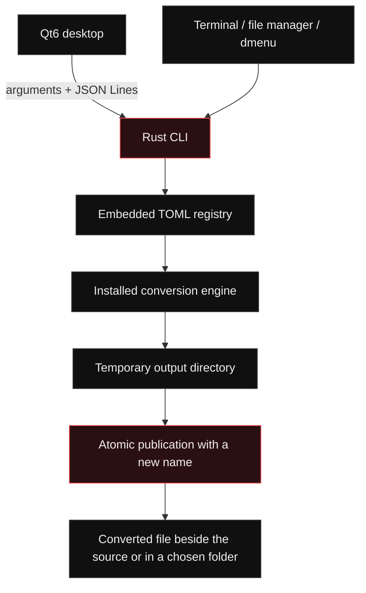

# Architecture

[Back to the README](../README.md)

Metroid separates its native desktop from conversion logic. The Rust executable
can run independently, and the Qt desktop communicates with it through subprocesses.
No HTTP server or network socket is involved in this interface.

## Source map

| Path | Responsibility |
| --- | --- |
| [`src/lib.rs`](../src/lib.rs) | Registry, executable discovery, subprocess execution, output publication |
| [`src/main.rs`](../src/main.rs) | CLI, JSON Lines worker, picker, desktop integrations |
| [`registry/conversions.toml`](../registry/conversions.toml) | Input/output routes and argument templates |
| [`desktop/main.cpp`](../desktop/main.cpp) | Qt window, file queue, format wheel, diagnostics, cancellation |
| [`tests/backends.rs`](../tests/backends.rs) | Integration tests with installed engines |
| [`scripts/`](../scripts/) | User installation scripts |
| [`.github/workflows/ci.yml`](../.github/workflows/ci.yml) | Build and test matrix |

## Conversion lifecycle

1. Canonicalize the input path and require a regular file.
2. Match its extension and the requested output against the embedded registry.
3. Resolve the engine through `PATH` and validate the output directory.
4. Create a temporary directory on the destination filesystem.
5. Expand whole argument tokens and launch the engine directly, without a shell.
6. Poll for completion, cancellation, or timeout; collect engine errors from a log.
7. Publish the output with a hard link that refuses existing destination names.
8. Remove the temporary directory when the operation returns.

The destination name is tried with increasing numeric suffixes. A concurrent
conversion or existing symlink cannot silently replace another destination. Hard-link
publication requires a supporting filesystem; there is no unsafe overwrite fallback.

## Process interfaces

- `formats FILE --json`: format objects with `target`, `category`, `backend`, and `available`.
- `doctor --json`: version, OS/session information, and executable availability.
- `convert FILE --to FORMAT --json`: one result object per input; errors set a nonzero exit status.
- `serve`: one input JSON request and one result per line, processed sequentially until EOF.

The desktop starts one conversion subprocess at a time. Cancellation uses a file in
a temporary directory observed by the Rust process. This is not yet a persistent
service or a process-tree sandbox. Engine descendants, resource limits, MIME sniffing,
and persistent queue recovery remain development work.

## Extending a route

Edit the TOML registry, rebuild the core, and test both a successful conversion and
failure cleanup. Templates support `{input}`, `{output}`, `{output_stem}`, and
`{writer}` as complete arguments. New routes must not require shell interpolation.
Do not expose an output in the desktop until its publication behavior is understood,
particularly for engines that emit multiple files.

## Primary interaction: compositor wheel

`integrations/kwin/plugin.cpp` adds the global Shift-drag gesture for KWin 6.8 Wayland.
The input filter activates only for a local file drag, reads its URI list through an
asynchronous pipe, and asks the CLI for common formats. `desktop/radialwheel.h` is
shared with the file-context fallback and provides rendering and sector hit testing.

The wheel is latched after a Shift tap. On release, the plugin cancels the original
source drag to prevent Shift's move behavior, then starts `metroid-desktop --convert-to`
as a separate job. Conversion processes do not run inside KWin. The default application
entry point is a tray companion; `--manager` opens the secondary batch window.

`tests/kwin_input.cpp` is an isolated-test-only input module, excluded by default and
never installed. Production installation copies only `metroid.so`. See the
[KWin guide](../integrations/kwin/README.md) for ABI constraints and test isolation.
