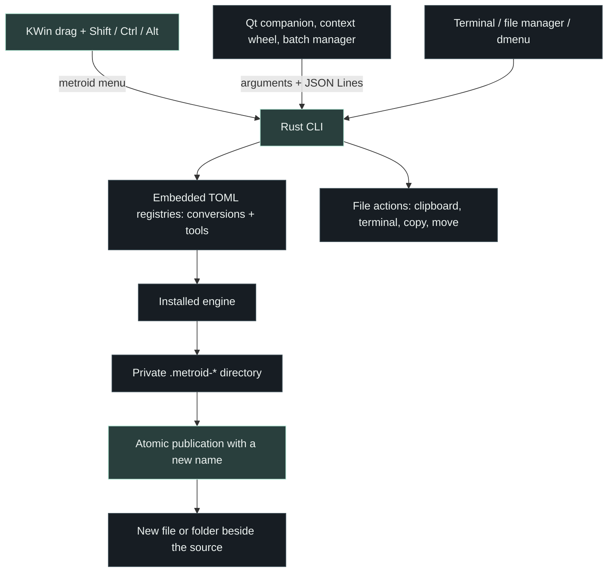

# Architecture

[Back to the README](../README.md)

Metroid separates its native desktop from conversion logic. The Rust executable
can run independently, and the Qt desktop communicates with it through subprocesses.
No HTTP server or network socket is involved in this interface.

## Source map

| Path | Responsibility |
| --- | --- |
| [`src/lib.rs`](../src/lib.rs) | Conversion registry, engine discovery, argument expansion, subprocess execution, publication, wheel menus |
| [`src/tools.rs`](../src/tools.rs) | Tool registry, selection rules, per-file and combining tool runs |
| [`src/actions.rs`](../src/actions.rs) | File actions: clipboard, terminal, share, float, reveal, copy/move without replacement |
| [`src/main.rs`](../src/main.rs) | CLI, JSON Lines worker, picker, autostart, desktop integrations |
| [`registry/conversions.toml`](../registry/conversions.toml) | Input/output routes and argument templates |
| [`registry/tools.toml`](../registry/tools.toml) | Tool definitions and argument templates |
| [`desktop/radialwheel.h`](../desktop/radialwheel.h) | The shared three-mode wheel: drawing, animation, hit testing, keyboard |
| [`desktop/main.cpp`](../desktop/main.cpp) | Tray companion, settings, context wheel, background jobs, batch manager |
| [`integrations/kwin/plugin.cpp`](../integrations/kwin/plugin.cpp) | Compositor input filter for the drag gesture |
| [`tests/`](../tests/) | Engine integration tests, wheel unit test, isolated KWin session |
| [`install.sh`](../install.sh), [`uninstall.sh`](../uninstall.sh) | Distribution-aware user installation and removal |
| [`scripts/`](../scripts/) | KWin build/installation, Windows installation, test harnesses |
| [`.github/workflows/ci.yml`](../.github/workflows/ci.yml) | Build and test matrix |

## Conversion lifecycle

1. Canonicalize the input path and require a regular file (tools and actions may accept folders).
2. Match its extension and the requested output against the embedded registry.
3. Resolve the engine through `PATH` and validate the output directory.
4. Create a temporary directory on the destination filesystem.
5. Expand whole argument tokens and launch the engine directly, without a shell.
6. Poll for completion, cancellation, or timeout; collect engine errors from a log.
7. Publish the output with a hard link that refuses existing destination names. Folder
   outputs (split pages, extraction) are moved into a directory created exclusively.
8. Remove the temporary directory when the operation returns.

The destination name is tried with increasing numeric suffixes. A concurrent
conversion or existing symlink cannot silently replace another destination. Hard-link
publication requires a supporting filesystem; there is no unsafe overwrite fallback.

## Process interfaces

- `menu convert|tools|actions PATH... --json`: the items a wheel shows for this selection,
  each with `id`, `label`, `category`, and `glyph`. Only usable items are returned.
- `tool ID PATH... --json`, `action ID PATH... [--dest DIR] --json`: one result line per output.
- `autostart enable|disable|status`: XDG autostart entry on Linux, `Run` key on Windows.
- `formats FILE --json`: format objects with `target`, `category`, `backend`, and `available`.
- `doctor --json`: version, OS/session information, and executable availability.
- `convert FILE --to FORMAT --json`: one result object per input; errors set a nonzero exit status.
- `serve`: one input JSON request and one result per line, processed sequentially until EOF.

The desktop starts one conversion subprocess at a time. Cancellation uses a file in
a temporary directory observed by the Rust process. This is not yet a persistent
service or a process-tree sandbox. Engine descendants, resource limits, MIME sniffing,
and persistent queue recovery remain development work.

## Extending a route

Edit a TOML registry, rebuild the core, and test both a successful run and failure
cleanup. Templates support these complete arguments: `{input}`, `{coded_input}` (ImageMagick `coder:path`), `{inputs}` (every
source), `{relative_inputs}` (bsdtar `-C dir name` pairs), `{archive_input}`,
`{output}`, `{output_stem}`, `{output_dir}` and `{output_dir}/name` (a private
directory for engines that choose their own file names), `{target}`, `{writer}`, and
`{office_profile}` (a private LibreOffice profile). Placeholders are matched only in
registry templates, never inside file names. New routes must not need a shell.

Each workspace also receives a restrictive ImageMagick policy (`MAGICK_CONFIGURE_PATH`)
and a pre-seeded LibreOffice profile. Desktop entry points pass paths after `--`, so a
file named like an option is never read as one.
Do not expose an output in the desktop until its publication behavior is understood,
particularly for engines that emit multiple files.

## Primary interaction: compositor wheels

`integrations/kwin/plugin.cpp` adds the global drag gesture for KWin 6.8 Wayland.
On a key press during a pointer drag that offers file URIs, the input filter reads
the URI list through an asynchronous pipe and asks `metroid menu` for the wheel that
key opens. Keys come from `~/.config/metroid/metroid.conf` (`[Wheels]` `Convert`,
`Tools`, `Actions`), written by the companion's settings and read again at each drag.
Another wheel key switches the mode and re-queries the same paths. Arrow keys and
Enter select from the keyboard; other keys are swallowed while the wheel is open.

On release, the plugin cancels the source drag so the file manager cannot complete a
move or copy, then starts `metroid-desktop --convert-to`, `--tool`, or `--action` as
a separate process. No engine runs inside KWin. `desktop/radialwheel.h` is shared by
the compositor, the file-manager context wheel (`metroid-desktop --wheel KIND`), and
the batch manager.

`tests/kwin_input.cpp` is an isolated-test-only input module, excluded by default and
never installed. Production installation copies only the production module as `metroid-<revision>.so`. See the
[KWin guide](../integrations/kwin/README.md) for ABI constraints and test isolation.
