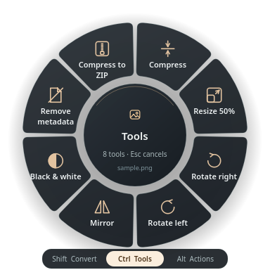
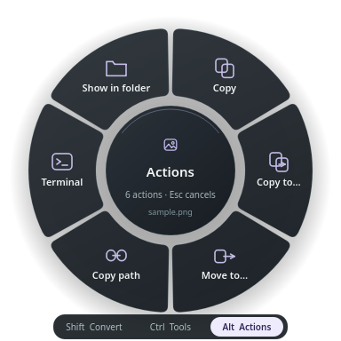
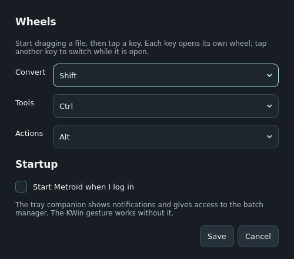

# Interaction guide

[Back to the README](../README.md)

## Drag, tap a key, drop

On KDE Plasma 6.8 (Wayland) with the [KWin integration](../integrations/kwin/README.md):

1. Start dragging one or more files or folders from your file manager.
2. Without releasing the mouse button, **tap** a key:
   - **Shift** opens **Convert**: the formats the selection can become;
   - **Ctrl** opens **Tools**: compress, resize, rotate, split, merge…;
   - **Alt** opens **Actions**: copy, move, share, terminal…
3. Release the key. The wheel stays open, centered where the pointer was.
4. Tap another of these keys to switch wheels without moving the wheel.
5. Move onto a sector (or press the arrow keys) and release the mouse button
   (or press Enter). The job runs locally and a notification reports the result.

The tabs under the wheel show which key opens which wheel; the active one is lit
in that wheel's color: mint for Convert, apricot for Tools, lilac for Actions.

|  |  |
| --- | --- |
| Ctrl: tools for the dragged image | Alt: actions for any file or folder |

Multiple selected items show only what they have in common. Folders accept the
actions and **Compress to ZIP**. Sources are never changed, except by **Move to…**,
which you choose explicitly.

## Output names

| Operation | Example |
| --- | --- |
| Conversion | `photo.png` → `photo.webp` |
| Per-file tool | `photo.jpg` → `photo-compressed.jpg`, `clip.mp4` → `clip-muted.mp4` |
| Combining tool | two PDFs → `Merged.pdf`; several items → `Archive.zip` |
| Folder output | `report.pdf` → `report-pages/`, `backup.tar.gz` → `backup/` |
| Name already taken | `photo-2.webp`, `photo-compressed-2.jpg` |

Existing files are never replaced. Outputs go beside the source.

## Cancel safely

Press **Escape**, or release in the center or outside the wheel. Nothing runs.
Releasing the key alone does not cancel. A key with no drag opens nothing, and a
drag with no key keeps the file manager's normal behavior. A key already held when
the drag starts is ignored: Ctrl-drag still copies and Shift-drag still moves.

When a wheel opens, Metroid cancels the original drag, so the file manager cannot
move or copy the source as a side effect. While an engine runs, a temporary tray icon
offers **Cancel**; cancellation stops the engine and leaves no partial output.

## Tools

| Family | Tool | Result |
| --- | --- | --- |
| Images | Compress | JPEG/WebP/AVIF re-encoded at quality 72 without metadata; PNG recompressed losslessly |
| | Resize 50% · Rotate right/left · Mirror · Black & white | Same format, new name |
| | Remove metadata | EXIF/XMP removed, orientation applied first |
| Video | Compress | H.264/AAC MP4 at CRF 28 (needs an FFmpeg with libx264) |
| | Remove audio · Half size · Rotate right · Speed ×2 | Same container |
| | First frame | PNG still image |
| Audio | Normalize volume (EBU R128) · Mono · Compress (96 kbit/s) | Same format |
| PDF | Compress (Ghostscript “ebook”), Rotate right | New PDF |
| | Merge | Two or more PDFs in selection order |
| | Split pages · Pages to PNG (300 dpi) | A new folder with one file per page |
| Archives | Extract | A new folder; entries cannot escape it |
| Anything | Compress to ZIP | Files and folders in one archive |

## Actions

| Action | What it does |
| --- | --- |
| Share | Sends the files to a paired phone with KDE Connect |
| Float | Opens a small drag helper (`dragon-drop`, `dragon`, `ripdrag`) so you can drop the files elsewhere later |
| Copy | Puts the files on the clipboard as a file list (`text/uri-list`), which Dolphin and most file managers paste |
| Copy to… / Move to… | Asks for a folder, then copies or moves without replacing anything |
| Copy path | Puts the full paths on the clipboard as text |
| Terminal | Opens a terminal in the file's folder (or in the folder itself) |
| Show in folder | Opens the file manager with the files selected |

Actions whose helper is missing are not shown.

## Settings and startup

Right-click the tray icon → **Settings…** to choose the key of each wheel (Shift,
Ctrl, Alt, or Off) and whether Metroid starts when you log in. Each wheel needs its
own key. Changes apply to the next drag; nothing needs restarting.

The settings live in `~/.config/metroid/metroid.conf`; startup uses the standard
`~/.config/autostart/metroid.desktop`. The KWin gesture works even when the tray
companion is not running.

## Without the drag gesture

On other desktops, right-click files → **Metroid** → **Convert with Metroid**,
**Metroid tools** or **Metroid actions** (Dolphin, Nemo; Nautilus lists them under
**Scripts**). The same wheel opens near the pointer. Click a sector to run it,
click a tab or press Shift/Ctrl/Alt to switch wheels, use the arrow keys and Enter,
or press Escape. Windows **Send to → Metroid** uses this path too.

## Optional batch manager

The tray menu's **Open batch manager** offers explicit queue management and
diagnostics. It can also be launched with `metroid-desktop --manager`.

View the secondary batch manager

Add files with **Add files** or `Ctrl+O`, select a common output format and optional
destination, then click **Convert**. **Clear** removes rows, not disk files. Files run
sequentially; errors do not stop the remaining queue. Hover over a status for details.
Closing during processing requests cancellation and keeps the window open until it
stops. The queue is not persisted between launches.

## Platform boundaries

The global gesture requires KWin 6.8 on Wayland. Other environments use the
context-menu wheels, the CLI, or the batch manager. Building on Windows does not
imply a native Windows drag gesture. See [Troubleshooting](TROUBLESHOOTING.md).
